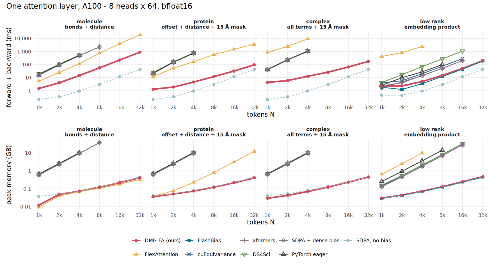
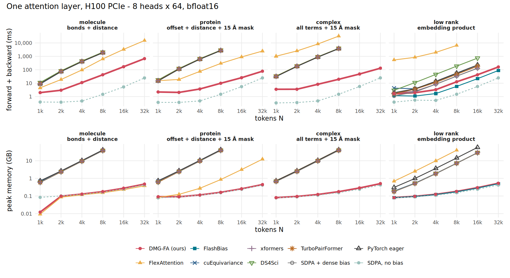
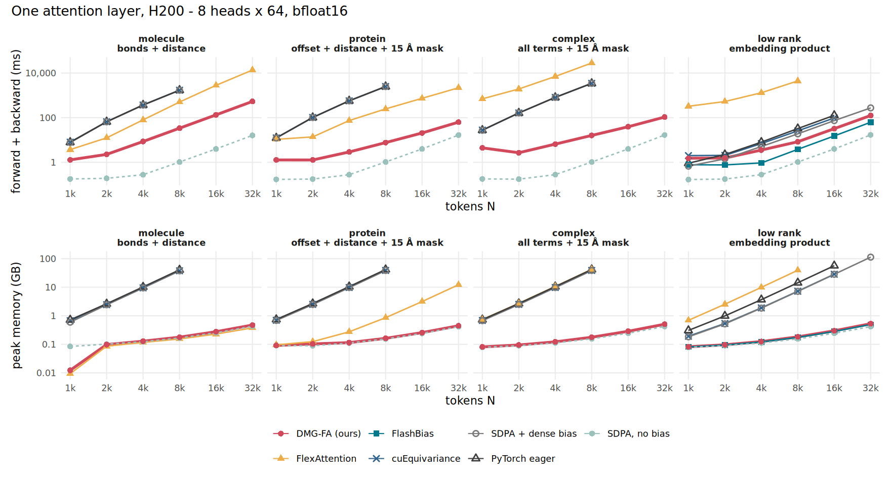

# Benchmarks

Speed, memory and accuracy of `molflash.attention` against other ways of computing the same attention. Everything here is produced by `benchmarks/run.py` and formatted by `benchmarks/report.py`; the commands to reproduce each table are given with it.

## What is compared

Every method computes the same function from the same terms, except the last row of each table, which drops the bias and gives the speed limit.

| method | how the bias is applied | stores an N × N tensor |
|---|---|---|
| `molflash` | computed inside the kernel from per-token inputs | no |
| `flex` | PyTorch FlexAttention (`torch.compile`d), the terms translated to `score_mod` and `mask_mod` | no |
| `flashbias` | FlashBias (Wu et al., NeurIPS 2025), low-rank factors appended to q and k; exact only for the `lowrank` scenario | no |
| `cuequivariance` | NVIDIA cuEquivariance 0.13.0 `attention_pair_bias`, bias precomputed densely; includes the op's own projections and gate | yes |
| `xformers` | xformers 0.0.35 `memory_efficient_attention` (cutlass) with the dense bias as a tensor | yes |
| `ds4sci` | DeepSpeed `DS4Sci_EvoformerAttention` (CUTLASS) with the dense bias; float16 and bfloat16 only | yes |
| `turbopairformer` | TurboPairFormer triangle-attention kernel with the dense bias; Hopper GPUs and bfloat16 only | yes |
| `sdpa+bias` | dense bias built in PyTorch, passed to `F.scaled_dot_product_attention` as a float mask | yes |
| `eager` | plain PyTorch, every `[B, H, N, N]` tensor explicit | yes |
| `sdpa (no bias)` | SDPA without any bias (FlashAttention-2 backend) | no |

Times are the median of 10 CUDA-event-timed calls after warm-up. "fwd+bwd" is one forward and one backward producing gradients for q, k, v and every learned tensor of the terms. Peak memory is `torch.cuda.max_memory_allocated` during the timed calls. bfloat16, batch 1, 8 heads of dimension 64 unless stated.

## Scenarios

Coordinates fill a sphere at the heavy-atom density of a protein (one atom per 20 ų), ordered along a space-filling curve so that sequence neighbours are spatial neighbours.

| scenario | terms |
|---|---|
| `molecule` | bonds (`EdgeBias`, 4 slots) + learned distance curve (128 points) |
| `protein` | relative position (±32) + learned distance curve + 15 Å cutoff mask |
| `complex` | bonds + distance curve + relative position + same chain + rank-8 bias from per-atom embeddings + 15 Å mask |
| `lowrank` | rank-16 bias from per-atom embeddings only |

## Results

### A100 (40 GB)

Forward plus backward time and peak memory per attention layer. OOM: out of memory on the 40 GB card. `> 30 s`: not run further because one step took longer than 30 s at a smaller size. n/a: the method cannot compute this scenario (FlashBias is exact only for the low-rank bias).

| scenario | method | N=4096 | N=16384 | N=32768 |
|---|---|---|---|---|
| complex | molflash | 12.7 ms, 0.07 GB | 65.2 ms, 0.24 GB | 176.9 ms, 0.45 GB |
| complex | flex | 9312.2 ms, 10.64 GB | OOM | OOM |
| complex | flashbias | n/a | n/a | n/a |
| complex | cuequivariance | 1061.2 ms, 9.72 GB | OOM | OOM |
| complex | xformers | 1057.0 ms, 9.68 GB | OOM | OOM |
| complex | ds4sci | 1109.9 ms, 9.94 GB | OOM | OOM |
| complex | sdpa+bias | 1057.1 ms, 9.69 GB | OOM | OOM |
| complex | eager | 1069.8 ms, 10.48 GB | OOM | OOM |
| complex | sdpa (no bias) | 0.9 ms, 0.08 GB | 11.5 ms, 0.24 GB | 43.8 ms, 0.44 GB |
| lowrank | molflash | 5.0 ms, 0.07 GB | 51.0 ms, 0.25 GB | 194.2 ms, 0.48 GB |
| lowrank | flex | 2396.1 ms, 9.86 GB | OOM | OOM |
| lowrank | flashbias | 3.4 ms, 0.07 GB | 45.0 ms, 0.23 GB | 189.2 ms, 0.44 GB |
| lowrank | cuequivariance | 20.0 ms, 1.84 GB | 286.7 ms, 28.50 GB | OOM |
| lowrank | xformers | 14.2 ms, 1.80 GB | 203.1 ms, 28.35 GB | OOM |
| lowrank | ds4sci | 70.4 ms, 2.11 GB | 1089.9 ms, 32.76 GB | OOM |
| lowrank | sdpa+bias | 14.0 ms, 1.80 GB | 202.6 ms, 28.35 GB | OOM |
| lowrank | eager | 27.5 ms, 3.62 GB | OOM | OOM |
| lowrank | sdpa (no bias) | 0.9 ms, 0.07 GB | 11.6 ms, 0.22 GB | 44.5 ms, 0.43 GB |
| molecule | molflash | 14.5 ms, 0.07 GB | 224.7 ms, 0.22 GB | 897.7 ms, 0.42 GB |
| molecule | flex | 115.6 ms, 0.07 GB | 4061.9 ms, 0.18 GB | 18718.1 ms, 0.33 GB |
| molecule | flashbias | n/a | n/a | n/a |
| molecule | cuequivariance | 491.1 ms, 9.45 GB | OOM | OOM |
| molecule | xformers | 486.2 ms, 9.38 GB | OOM | OOM |
| molecule | ds4sci | 538.6 ms, 9.64 GB | OOM | OOM |
| molecule | sdpa+bias | 485.1 ms, 9.40 GB | OOM | OOM |
| molecule | eager | 498.9 ms, 10.19 GB | OOM | OOM |
| molecule | sdpa (no bias) | 0.9 ms, 0.08 GB | 11.5 ms, 0.23 GB | 43.6 ms, 0.44 GB |
| protein | molflash | 4.6 ms, 0.07 GB | 32.3 ms, 0.22 GB | 95.9 ms, 0.41 GB |
| protein | flex | 167.2 ms, 0.23 GB | 1500.5 ms, 3.10 GB | 3578.8 ms, 12.18 GB |
| protein | flashbias | n/a | n/a | n/a |
| protein | cuequivariance | 745.4 ms, 9.72 GB | OOM | OOM |
| protein | xformers | 741.8 ms, 9.66 GB | OOM | OOM |
| protein | ds4sci | 794.0 ms, 9.92 GB | OOM | OOM |
| protein | sdpa+bias | 743.2 ms, 9.69 GB | OOM | OOM |
| protein | eager | 755.6 ms, 10.48 GB | OOM | OOM |
| protein | sdpa (no bias) | 0.9 ms, 0.08 GB | 11.5 ms, 0.23 GB | 44.0 ms, 0.44 GB |



Notes on the baselines:

- FlexAttention computes the same function and agrees with the reference (see Accuracy). It cannot differentiate through two reads of one captured tensor, so the baseline passes interpolation tables as separate value and slope tensors and edge values as one tensor per slot. A `mask_mod` with captured tensors failed in the compiled backward on this PyTorch version (2.14), so the mask is applied in `score_mod` and the block mask only skips empty blocks.
- FlashBias needs all eight arguments of `flash_bias_func` passed explicitly; with the defaults its backward fails on an index error. On the A100 its output agrees with the reference (largest relative error 3.9e-3 in bfloat16, as for molflash). On the H100 and H200 it deviated by 6 to 11% in our runs; its authors describe the Triton kernel as tested on A100 only, so the Hopper FlashBias timings below are of a kernel that does not compute the intended result.
- xformers, DS4Sci and TurboPairFormer pin older PyTorch versions (2.10) and run in separate environments; they receive the same dense bias as SDPA. DS4Sci turns `-inf` in the bias into NaN, so masked pairs get -30,000 instead, which removes them equally.
- cuEquivariance `attention_pair_bias` projects its own queries, keys, values and output gate from a single representation, so its time includes those projections and its output is a different function. Its bias input is the dense `[B, H, N, N]` tensor, so its memory grows as N².

### H100

NVIDIA H100 PCIe (80 GB). Same layout as the A100 table.

| scenario | method | N=4096 | N=16384 | N=32768 |
|---|---|---|---|---|
| complex | molflash | 8.3 ms, 0.12 GB | 48.1 ms, 0.29 GB | 131.3 ms, 0.51 GB |
| complex | flex | 8301.9 ms, 10.68 GB | > 30 s | > 30 s |
| complex | flashbias | n/a | n/a | n/a |
| complex | cuequivariance | 881.8 ms, 9.77 GB | OOM | OOM |
| complex | xformers | 897.2 ms, 9.73 GB | OOM | OOM |
| complex | ds4sci | 934.0 ms, 9.74 GB | OOM | OOM |
| complex | turbopairformer | 899.9 ms, 9.73 GB | OOM | OOM |
| complex | sdpa+bias | 877.6 ms, 9.73 GB | OOM | OOM |
| complex | eager | 882.4 ms, 10.52 GB | OOM | OOM |
| complex | sdpa (no bias) | 0.5 ms, 0.11 GB | 5.6 ms, 0.24 GB | 24.9 ms, 0.42 GB |
| lowrank | molflash | 3.3 ms, 0.12 GB | 42.5 ms, 0.30 GB | 162.6 ms, 0.53 GB |
| lowrank | flex | 1968.4 ms, 9.90 GB | OOM | OOM |
| lowrank | flashbias | 1.7 ms, 0.12 GB | 21.6 ms, 0.28 GB | 88.5 ms, 0.50 GB |
| lowrank | cuequivariance | 12.0 ms, 1.89 GB | 188.8 ms, 28.55 GB | OOM |
| lowrank | xformers | 8.3 ms, 1.85 GB | 130.4 ms, 28.40 GB | OOM |
| lowrank | ds4sci | 45.1 ms, 1.86 GB | 742.2 ms, 28.45 GB | OOM |
| lowrank | turbopairformer | 11.4 ms, 1.85 GB | 183.5 ms, 28.42 GB | OOM |
| lowrank | sdpa+bias | 8.4 ms, 1.86 GB | 130.0 ms, 28.41 GB | OOM |
| lowrank | eager | 13.9 ms, 3.68 GB | 227.9 ms, 56.87 GB | OOM |
| lowrank | sdpa (no bias) | 0.5 ms, 0.11 GB | 5.6 ms, 0.24 GB | 24.7 ms, 0.42 GB |
| molecule | molflash | 11.1 ms, 0.13 GB | 169.0 ms, 0.28 GB | 678.8 ms, 0.47 GB |
| molecule | flex | 96.9 ms, 0.12 GB | 3324.9 ms, 0.23 GB | 15123.2 ms, 0.38 GB |
| molecule | flashbias | n/a | n/a | n/a |
| molecule | cuequivariance | 405.3 ms, 9.49 GB | OOM | OOM |
| molecule | xformers | 413.1 ms, 9.38 GB | OOM | OOM |
| molecule | ds4sci | 450.5 ms, 9.39 GB | OOM | OOM |
| molecule | turbopairformer | 416.2 ms, 9.38 GB | OOM | OOM |
| molecule | sdpa+bias | 401.7 ms, 9.46 GB | OOM | OOM |
| molecule | eager | 407.0 ms, 10.25 GB | OOM | OOM |
| molecule | sdpa (no bias) | 0.5 ms, 0.12 GB | 5.3 ms, 0.25 GB | 24.5 ms, 0.43 GB |
| protein | molflash | 3.7 ms, 0.11 GB | 25.7 ms, 0.26 GB | 78.2 ms, 0.45 GB |
| protein | flex | 75.7 ms, 0.27 GB | 905.9 ms, 3.15 GB | 2477.0 ms, 12.23 GB |
| protein | flashbias | n/a | n/a | n/a |
| protein | cuequivariance | 615.3 ms, 9.76 GB | OOM | OOM |
| protein | xformers | 630.5 ms, 9.66 GB | OOM | OOM |
| protein | ds4sci | 667.4 ms, 9.67 GB | OOM | OOM |
| protein | turbopairformer | 633.3 ms, 9.66 GB | OOM | OOM |
| protein | sdpa+bias | 611.2 ms, 9.73 GB | OOM | OOM |
| protein | eager | 615.7 ms, 10.52 GB | OOM | OOM |
| protein | sdpa (no bias) | 0.5 ms, 0.11 GB | 5.5 ms, 0.24 GB | 24.7 ms, 0.42 GB |

### H200

NVIDIA H200 (141 GB). Same layout as the A100 table.

| scenario | method | N=4096 | N=16384 | N=32768 |
|---|---|---|---|---|
| complex | molflash | 6.5 ms, 0.12 GB | 39.2 ms, 0.29 GB | 106.7 ms, 0.51 GB |
| complex | flex | 7031.1 ms, 10.68 GB | OOM | OOM |
| complex | flashbias | n/a | n/a | n/a |
| complex | cuequivariance | 811.1 ms, 9.77 GB | OOM | OOM |
| complex | turbopairformer | 811.9 ms, 9.73 GB | OOM | OOM |
| complex | sdpa+bias | 809.5 ms, 9.73 GB | OOM | OOM |
| complex | eager | 812.0 ms, 10.52 GB | OOM | OOM |
| complex | sdpa (no bias) | 0.3 ms, 0.11 GB | 4.0 ms, 0.24 GB | 16.7 ms, 0.42 GB |
| lowrank | molflash | 3.5 ms, 0.12 GB | 32.2 ms, 0.30 GB | 125.4 ms, 0.53 GB |
| lowrank | flex | 1310.6 ms, 9.90 GB | n/a | n/a |
| lowrank | flashbias | 0.9 ms, 0.12 GB | 15.2 ms, 0.28 GB | 62.5 ms, 0.50 GB |
| lowrank | cuequivariance | 6.9 ms, 1.89 GB | 97.1 ms, 28.55 GB | OOM |
| lowrank | turbopairformer | 6.8 ms, 1.85 GB | 109.9 ms, 28.42 GB | 424.3 ms, 113.27 GB |
| lowrank | sdpa+bias | 5.1 ms, 1.86 GB | 74.0 ms, 28.41 GB | 273.9 ms, 113.24 GB |
| lowrank | eager | 8.0 ms, 3.68 GB | 127.7 ms, 56.87 GB | OOM |
| lowrank | sdpa (no bias) | 0.3 ms, 0.11 GB | 4.0 ms, 0.24 GB | 16.9 ms, 0.42 GB |
| molecule | molflash | 8.6 ms, 0.13 GB | 133.5 ms, 0.28 GB | 534.9 ms, 0.47 GB |
| molecule | flex | 79.8 ms, 0.12 GB | 2807.6 ms, 0.23 GB | 13638.8 ms, 0.38 GB |
| molecule | flashbias | n/a | n/a | n/a |
| molecule | cuequivariance | 369.3 ms, 9.49 GB | OOM | OOM |
| molecule | turbopairformer | 369.8 ms, 9.38 GB | OOM | OOM |
| molecule | sdpa+bias | 367.8 ms, 9.46 GB | OOM | OOM |
| molecule | eager | 370.9 ms, 10.25 GB | OOM | OOM |
| molecule | sdpa (no bias) | 0.3 ms, 0.12 GB | 4.0 ms, 0.25 GB | 16.1 ms, 0.43 GB |
| protein | molflash | 2.9 ms, 0.11 GB | 20.6 ms, 0.26 GB | 63.1 ms, 0.45 GB |
| protein | flex | 74.2 ms, 0.27 GB | 737.5 ms, 3.15 GB | 2186.1 ms, 12.23 GB |
| protein | flashbias | n/a | n/a | n/a |
| protein | cuequivariance | 569.5 ms, 9.76 GB | OOM | OOM |
| protein | turbopairformer | 570.2 ms, 9.66 GB | OOM | OOM |
| protein | sdpa+bias | 567.7 ms, 9.73 GB | OOM | OOM |
| protein | eager | 569.9 ms, 10.52 GB | OOM | OOM |
| protein | sdpa (no bias) | 0.3 ms, 0.11 GB | 4.0 ms, 0.24 GB | 16.7 ms, 0.41 GB |

On Hopper the kernel is further from the speed of attention without a bias than on the A100: it is not tuned for that architecture (no TMA or warp specialisation), and plain attention through the same kernel takes 2.9 ms at N = 8192 on the H100 against 1.5 ms for SDPA. The same holds against FlashBias on the low-rank scenario, where FlashBias is about 2× faster on the H100 and H200 and within 3 to 13% on the A100. In the scenarios with distances, bonds and masks the comparison with the other methods is the same on all three GPUs.




## Cost of each primitive

N = 8192, 8 heads of 64, bfloat16. Each row adds one term to plain attention computed by the same kernel. Tables in rows 2 to 5 require grad.

| GPU | N | primitive | forward ms | x no terms | fwd+bwd ms | x no terms |
|---|---|---|---|---|---|---|
| NVIDIA A100-SXM4-40GB | 8192 | none | 2.10 | 1.00 | 7.53 | 1.00 |
| NVIDIA A100-SXM4-40GB | 8192 | EdgeBias (4 slots) | 3.52 | 1.68 | 15.72 | 2.09 |
| NVIDIA A100-SXM4-40GB | 8192 | NodeBias (rank 8) | 3.40 | 1.62 | 18.03 | 2.40 |
| NVIDIA A100-SXM4-40GB | 8192 | PairBias code | 5.07 | 2.42 | 27.52 | 3.66 |
| NVIDIA A100-SXM4-40GB | 8192 | PairBias interpolated | 4.28 | 2.04 | 52.45 | 6.97 |
| NVIDIA A100-SXM4-40GB | 8192 | PairMask (15 A) | 1.84 | 0.88 | 5.33 | 0.71 |
| NVIDIA A100-SXM4-40GB | 8192 | PairScale | 4.31 | 2.05 | 12.60 | 1.67 |
| NVIDIA A100-SXM4-40GB | 8192 | PairGate | 3.82 | 1.82 | 11.99 | 1.59 |

On the A100 a mask makes the kernel faster than no terms at all, because tiles beyond the 15 Å cutoff are skipped. The ratios are larger on Hopper because the plain kernel is faster there while the term arithmetic is not. The backward pass is dominated by accumulating table gradients: an interpolated table of 64 points costs 7× the plain kernel when it is learned, and about 2× when it is frozen. Tables of up to 32 entries are accumulated in registers and cost roughly half as much as larger ones.

## Accuracy

Largest relative error (max |error| / max |reference|) against plain PyTorch in float32 on the same rounded inputs, N = 2048, A100. "worst parameter grad" covers every learned tensor of the terms.

| scenario | method | dtype | output | worst q/k/v grad | worst parameter grad |
|---|---|---|---|---|---|
| molecule | molflash | bf16 | 2.3e-03 | 5.3e-03 | 5.2e-03 |
| molecule | flex | bf16 | 2.3e-03 | 5.3e-03 | 5.1e-03 |
| molecule | sdpa+bias | bf16 | 3.3e-03 | 4.9e-03 | 1.1e-02 |
| molecule | molflash | fp16 | 2.8e-04 | 6.2e-04 | 4.5e-04 |
| molecule | flex | fp16 | 2.8e-04 | 6.2e-04 | 4.2e-04 |
| molecule | sdpa+bias | fp16 | 4.5e-04 | 1.0e-03 | 5.7e-04 |
| molecule | molflash | fp32 | 2.2e-06 | 1.6e-06 | 2.9e-05 |
| molecule | flex | fp32 | 2.0e-06 | 9.8e-07 | 7.6e-05 |
| molecule | sdpa+bias | fp32 | 2.8e-06 | 3.3e-06 | 2.7e-05 |
| protein | molflash | bf16 | 2.6e-03 | 5.8e-03 | 2.7e-03 |
| protein | flex | bf16 | 2.6e-03 | 5.8e-03 | 2.7e-03 |
| protein | sdpa+bias | bf16 | 3.1e-03 | 5.8e-03 | 4.7e-03 |
| protein | molflash | fp16 | 3.6e-04 | 8.0e-04 | 2.7e-04 |
| protein | flex | fp16 | 3.6e-04 | 8.0e-04 | 2.9e-04 |
| protein | sdpa+bias | fp16 | 3.6e-04 | 9.5e-04 | 4.8e-04 |
| protein | molflash | fp32 | 1.5e-06 | 6.4e-07 | 1.0e-05 |
| protein | flex | fp32 | 1.6e-06 | 7.5e-07 | 2.6e-05 |
| protein | sdpa+bias | fp32 | 2.0e-06 | 2.5e-06 | 1.7e-05 |
| complex | molflash | bf16 | 2.8e-03 | 4.5e-03 | 4.7e-03 |
| complex | flex | bf16 | 2.8e-03 | 4.5e-03 | 4.8e-03 |
| complex | sdpa+bias | bf16 | 3.8e-03 | 5.9e-03 | 5.1e-03 |
| complex | molflash | fp16 | 3.4e-04 | 6.0e-04 | 8.0e-04 |
| complex | flex | fp16 | 3.4e-04 | 6.0e-04 | 8.1e-04 |
| complex | sdpa+bias | fp16 | 4.1e-04 | 6.9e-04 | 1.5e-03 |
| complex | molflash | fp32 | 8.5e-07 | 8.7e-07 | 1.4e-05 |
| complex | flex | fp32 | 4.7e-07 | 8.3e-07 | 1.4e-05 |
| complex | sdpa+bias | fp32 | 1.2e-06 | 2.0e-06 | 2.2e-05 |
| lowrank | molflash | bf16 | 2.6e-03 | 3.8e-03 | 1.8e-03 |
| lowrank | flex | bf16 | 3.9e-03 | 3.8e-03 | 1.8e-03 |
| lowrank | sdpa+bias | bf16 | 4.5e-03 | 5.1e-03 | 3.6e-03 |
| lowrank | molflash | fp16 | 2.4e-04 | 7.1e-04 | 2.4e-04 |
| lowrank | flex | fp16 | 4.2e-04 | 7.1e-04 | 2.4e-04 |
| lowrank | sdpa+bias | fp16 | 6.1e-04 | 7.2e-04 | 5.2e-04 |
| lowrank | molflash | fp32 | 2.4e-06 | 1.0e-06 | 7.5e-07 |
| lowrank | flex | fp32 | 5.3e-07 | 7.4e-07 | 8.7e-07 |
| lowrank | sdpa+bias | fp32 | 2.1e-06 | 3.0e-06 | 1.1e-06 |

molflash is as accurate as FlexAttention and SDPA with a dense bias in every precision. cuEquivariance is not listed because it computes a different function (see above).

## Reproducing

```
python benchmarks/run.py speed --out results.jsonl
python benchmarks/run.py primitives --n 8192 --out results.jsonl
python benchmarks/run.py accuracy --n 2048 --out results.jsonl
python benchmarks/report.py results.jsonl
```

The per-term ablation and the table-gradient mode sweep (registers against private buffers, by table size) print JSON lines: `python benchmarks/ablate_terms.py` and `python benchmarks/grad_mode_sweep.py`.

The FlashBias baseline needs `flash_bias_triton.py` from https://github.com/thuml/FlashBias on the path given by `MOLFLASH_FLASHBIAS`. The cuEquivariance baseline needs `pip install cuequivariance-torch cuequivariance-ops-torch-cu13`.
